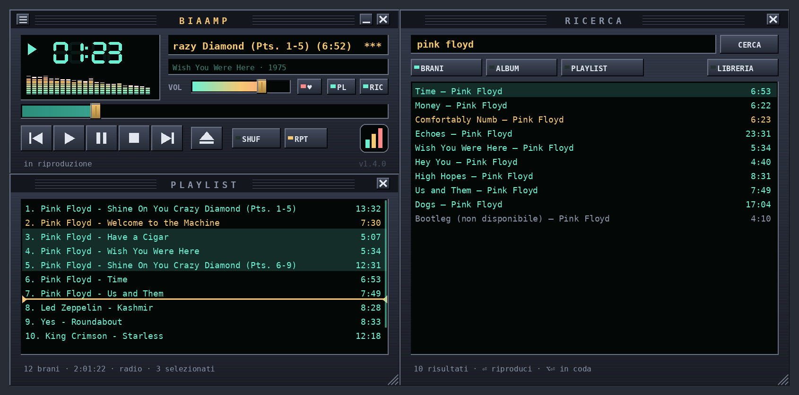

# BiaAmp

**Lettore per YouTube Music con interfaccia a deck in stile anni Novanta, nativo per macOS.**



*Anteprima generata dal banco di prova a partire dal codice di disegno di `app.py`.*

BiaAmp usa il servizio di YouTube Music (con il tuo account, Premium compreso) ma lo
comanda da una finestra a deck disegnata a mano: display a sette segmenti, analizzatore
di spettro con picchi, oscilloscopio, playlist e pannello di ricerca agganciati. La pagina
di YouTube Music resta disponibile come **Libreria** per l'accesso e per sfogliare.

## Caratteristiche

- Analizzatore di spettro reale (FFT dell'audio in riproduzione) a 22 bande logaritmiche,
  con balistica fisica di barre e picchi; in alternativa oscilloscopio con trigger.
- Ricerca integrata di brani, album e playlist: riproduci subito, dopo il brano attuale o
  in fondo alla coda.
- Tre dimensioni (1×, 1,5× classica, 2×).
- Display del tempo trascorso o rimanente, titolo in scorrimento, volume, posizione.
- Playlist modificabile: si riordina trascinando le righe, si sposta con `⌥↑` `⌥↓`, si
  svuota con `⌫`; `⌘Z` annulla l'ultima modifica.
- Finestre che si agganciano magneticamente tra loro e ai bordi dello schermo, vengono in
  primo piano insieme e si riducono nel Dock insieme al lettore.
- Centro di Controllo di macOS con copertina e tasti multimediali della tastiera.
- Mi piace, riproduzione casuale, ripetizione (no / tutto / uno).
- Nessun Electron: Python + Cocoa nativo (PyObjC).

## Installazione

1. Scarica `BiaAmp-x.y.z-macOS.dmg` dalla pagina [Releases](https://github.com/braucci/biaamp/releases).
2. Apri il DMG e trascina **BiaAmp** in **Applicazioni**.
3. Primo avvio: l'app non è autenticata da Apple, quindi macOS la blocca.
   Vai in **Impostazioni di Sistema ▸ Privacy e sicurezza** e premi **Apri comunque**.
   In alternativa, dal Terminale:

   ```bash
   xattr -dr com.apple.quarantine /Applications/BiaAmp.app
   ```

4. Nella finestra **Libreria** accedi al tuo account Google (una volta sola), poi cerca
   un brano nel pannello **Ricerca** (tasto `L`).

Requisiti: macOS 14 Sonoma o successivo, Mac con Apple Silicon (M1 e successivi).

## Tasti

| Tasto | Azione | Tasto | Azione |
|---|---|---|---|
| `Z` | brano precedente | `B` | brano successivo |
| `X` | play (da capo se già in riproduzione) | `C` | pausa / riprendi |
| `V` | stop | `Spazio` | play / pausa |
| `←` `→` | indietro / avanti di 5 s | `↑` `↓` | volume ± 5 % |
| `L` o `⏏` | cerca | `S` / `R` | casuale / ripetizione |
| `⌘1`…`⌘4` | lettore, playlist, ricerca, libreria | `⌘R` | ricarica YouTube Music |

Clic sul display del tempo: trascorso ↔ rimanente. Clic sull'analizzatore:
spettro → oscilloscopio → spento. Rotellina sul lettore: volume. Dimensione:
*Vista ▸ Dimensione* o clic destro sul lettore.

Nella playlist:

| Tasto o gesto | Azione |
|---|---|
| clic · `⇧`-clic · `⌘`-clic | seleziona una riga · un intervallo · aggiunge o toglie una riga |
| `↑` `↓` (con `⇧` estende) · `⌘A` · `Esc` | muove la selezione · seleziona tutto · deseleziona |
| trascinare le righe selezionate | le sposta dove indica la linea dorata |
| `⌥↑` `⌥↓` | sposta su / giù i brani selezionati |
| `⌫` | toglie i brani dalla coda, anche dalla copia sul server di YouTube Music (quello in riproduzione resta) |
| `⌘Z` | annulla l'ultimo spostamento o l'ultima rimozione |
| doppio clic · `⏎` | riproduce il brano |
| clic destro | menu: *Riproduci dopo il brano attuale*, *Sposta in fondo*, *Rimuovi i brani successivi*, *Ferma la radio* |

Se nel piede della playlist compare «radio», la coda viene da una radio o da un Mix e
YouTube Music la allunga da sé quando sta per finire. Togliere un brano la ferma (la coda
diventa tua: «radio fermata»); *Ferma la radio* lo fa senza togliere nulla. Attenzione a
**SHUF** su una radio: YouTube Music chiede al server una sequenza nuova, che rimpiazza la
coda che hai sistemato a mano.

Nei risultati della ricerca: doppio clic o `⏎` riproduce subito, `⇧⏎` dopo il brano
attuale, `⌥⏎` (o `⌥` doppio clic) in fondo alla coda; clic destro per il menu; `↓` dal
campo passa ai risultati, `Esc` torna al campo.

## Costruire dai sorgenti (senza Xcode)

Serve solo il Python di [python.org](https://www.python.org/downloads/macos/) (3.14 consigliato).

```bash
git clone https://github.com/braucci/biaamp.git
cd biaamp
bash build.sh      # autotest, dipendenze, BiaAmp.app, ZIP e DMG in dist/
bash installa.sh   # copia in /Applicazioni e avvia
```

I dettagli tecnici (architettura, ponte JavaScript, fisica dell'analizzatore,
verifiche, risoluzione dei problemi) sono in [README-progetto.md](README-progetto.md).

## Crediti e licenza

© 2026 B. Raucci — [Licenza MIT](LICENSE).

Derivato da [youtube-music-macos](https://github.com/0xjemm/youtube-music-macos) di jem (MIT).
YouTube Music è un marchio di Google LLC; BiaAmp non è affiliato a Google né a YouTube.
L'interfaccia e l'icona sono opere originali, ispirate ai lettori audio degli anni Novanta.
